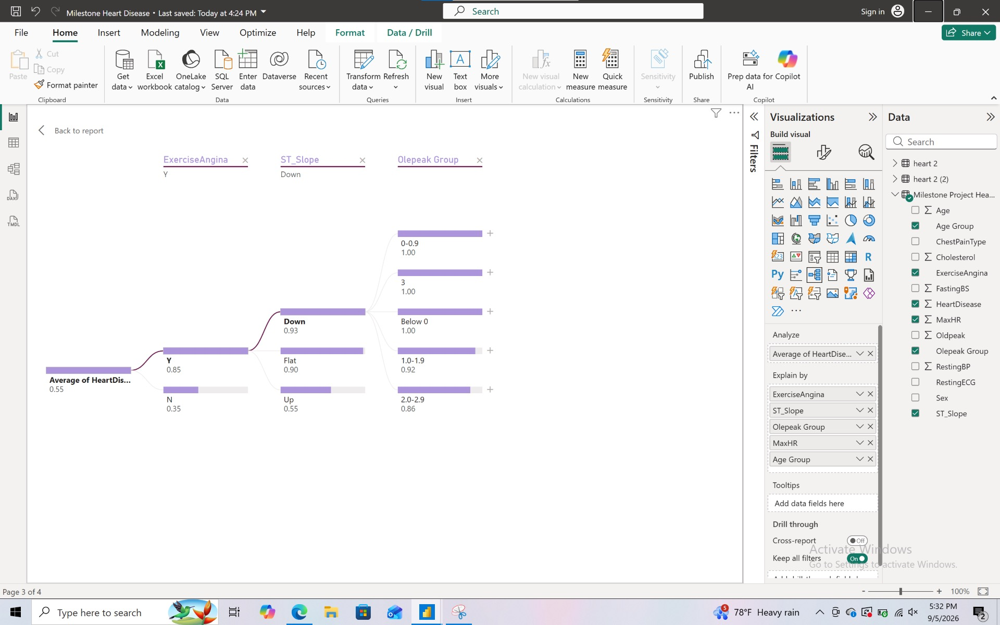

# Heart Disease Risk Analysis

## 📊 Project Overview

This project explores clinical risk factors associated with heart disease using data visualization and decision modeling techniques.

The objective was to identify patterns in patient characteristics that could help healthcare professionals prioritize patients for further cardiovascular evaluation.

## 🎯 Project Objectives

- Explore relationships between clinical characteristics and heart disease outcomes.
- Identify variables associated with elevated cardiovascular risk.
- Develop a structured approach to clinical risk stratification.
- Communicate findings using Power BI visualizations.

## 🛠️ Tools and Technologies

- Microsoft Power BI
- Power Query
- DAX
- Multi-Attribute Utility Theory (MAUT)
- Exploratory Data Analysis

## 📁 Dataset

The project used the publicly available Heart Failure Prediction Dataset, containing 918 patient records and 11 clinical variables.

Variables included age, chest pain type, resting blood pressure, cholesterol, exercise-induced angina, and ST slope.

## 🔍 Methodology

**1. Data Preparation**

Reviewed the dataset for missing values, inconsistent entries, and potential data quality issues.

**2. Exploratory Data Analysis**

Examined relationships between patient characteristics and heart disease outcomes.

**3. Decision Modeling**

Used a Power BI decomposition tree to explore risk patterns and a weighted MAUT scoring model to support patient prioritization.

**4. Model Evaluation**

Examined branch patterns and sensitivity to modeling assumptions.

## 📈 Key Findings

- Exercise-induced angina emerged as an important variable for distinguishing higher-risk groups.
- Chest pain type and ST slope provided additional information for risk stratification.
- Combining visualization with weighted scoring helped organize clinical risk factors into a decision-support framework.

## 📊 Project Visualizations

### Power BI Decomposition Tree: Heart Disease Risk Factors

This decomposition tree explores relationships between
heart disease outcomes and clinical variables, including
exercise-induced angina, ST slope, and Oldpeak groups.

Exercise-induced angina emerged as an important
first-level split, highlighting differences in
observed heart disease prevalence between patient
groups.

### Power BI Decomposition Tree: Chest Pain Type and Age Groups

This Power BI decomposition tree explores how
exercise-induced angina, chest pain type, and age
groups relate to observed heart disease prevalence.

The visualization highlights differences across
patient subgroups and demonstrates how multiple
clinical characteristics can be explored to
identify patterns associated with cardiovascular risk.

These findings are exploratory and do not establish
causal relationships or provide a clinically
validated prediction.

## ⚠️ Limitations
This analysis is exploratory and is not a clinically validated diagnostic tool. Results may be affected by dataset characteristics, model assumptions, and unmeasured factors. Clinical use would require additional validation and appropriate professional oversight.

## 🚀 Future Improvements
Evaluate the model using additional datasets.

Compare results with statistical and machine learning approaches.

Explore additional clinical predictors.

Improve visualization and reporting for healthcare audiences.

## 📌 Project Status
Completed academic data analytics project featuring
Power BI decomposition trees, clinical risk factor
analysis, and decision modeling techniques.
